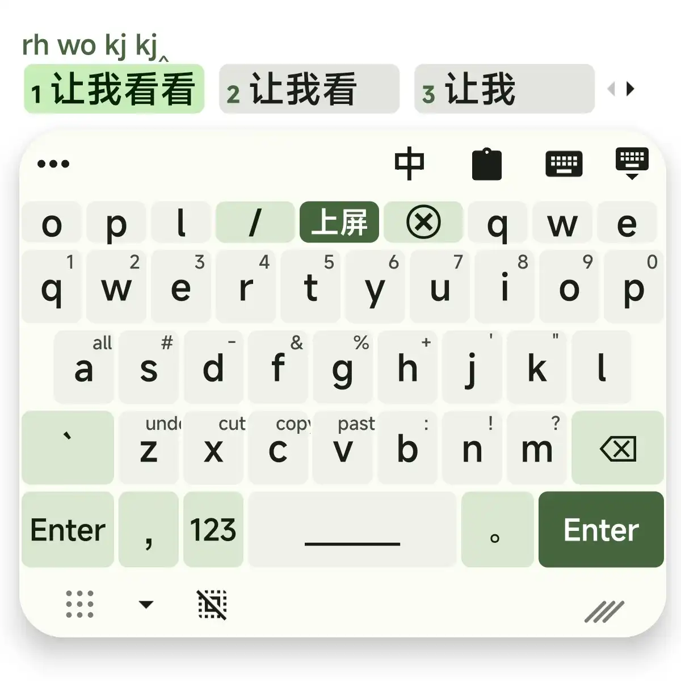
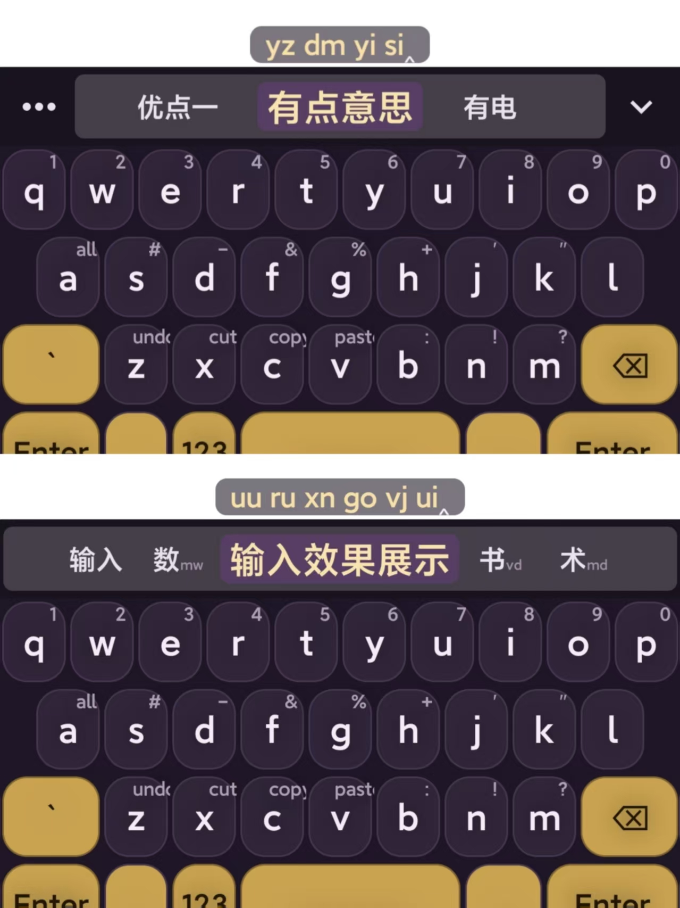
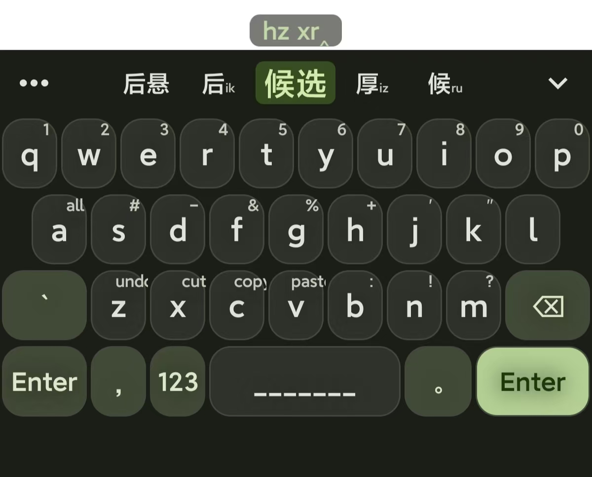
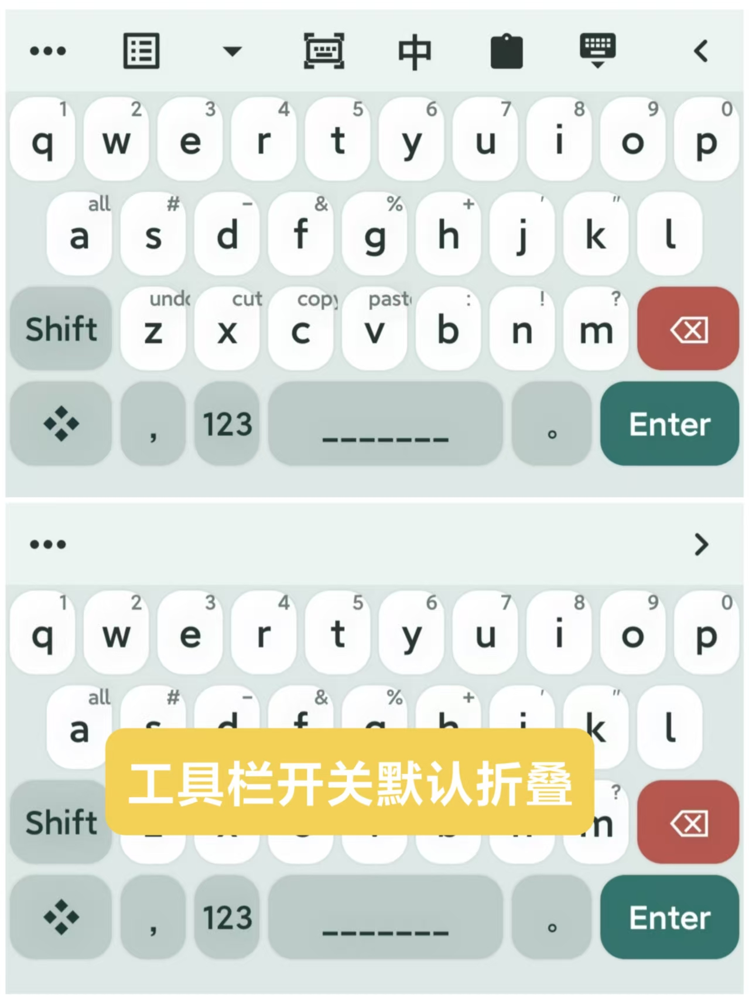
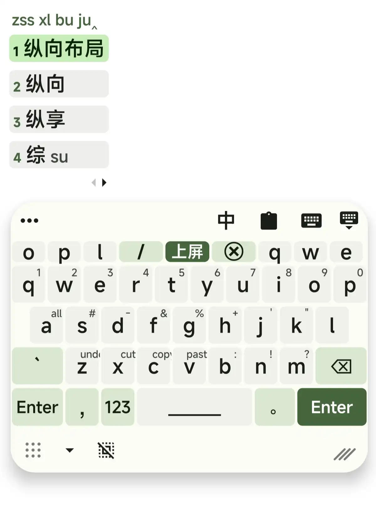
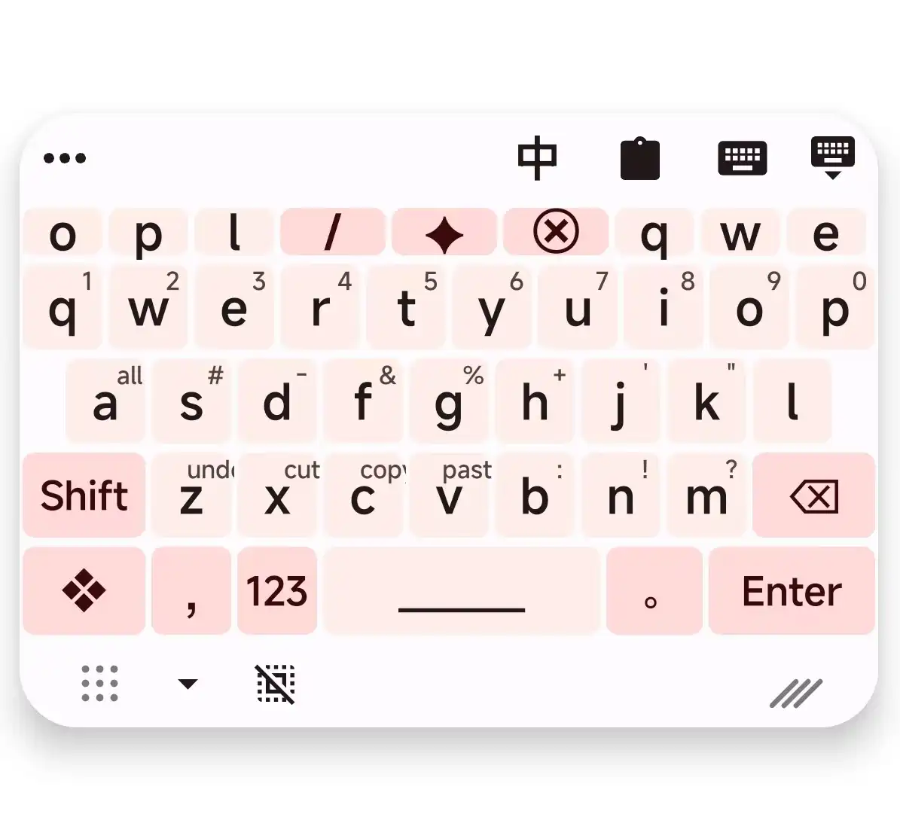
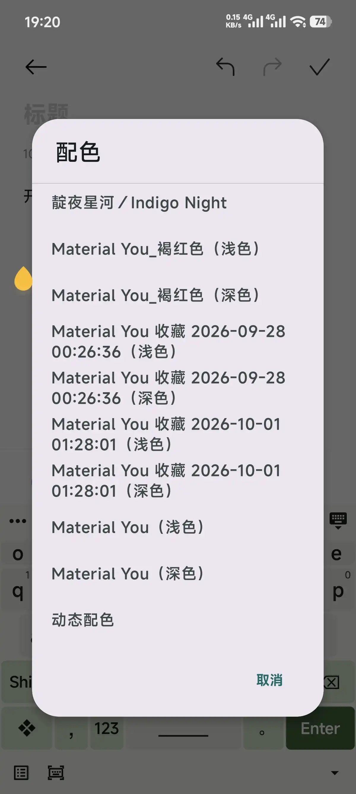
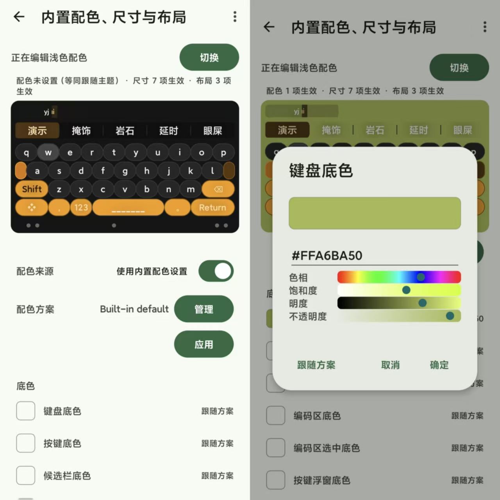
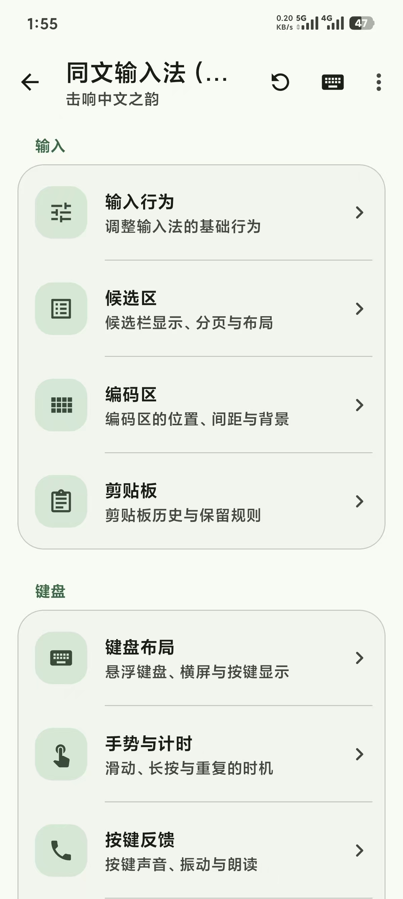
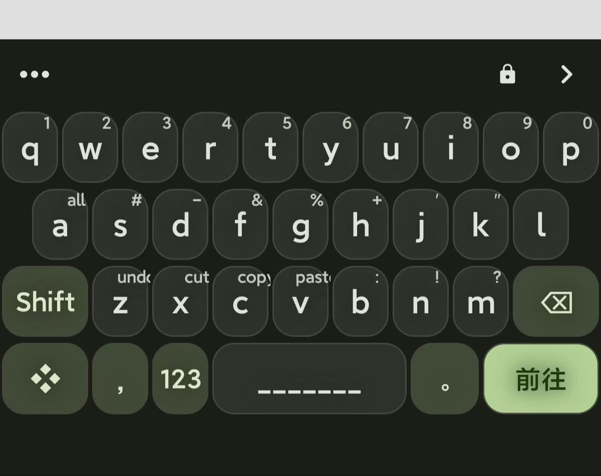

<!--
SPDX-FileCopyrightText: 2015 - 2024 Rime community

SPDX-License-Identifier: GPL-3.0-or-later
-->

# Trime —— 个人修改版（Personal Modified Build）

本仓库是作者个人修改的 Trime 版本，并非新项目：全部内容基于原项目 同文输入法 Trime 修改而来，
与原项目**无隶属关系，也不是官方发布版**。原代码、文档与素材的著作权归 Rime community 所有，
许可证为 GPL-3.0-or-later。遇到问题请在本仓库反馈，**不要**提到原项目去。

本仓库相对原版的改动，是在 AI 助手辅助下以「vibe coding」方式完成的：作者用自然语言描述需求，
由 AI 编写与修改代码，随后每一项改动都在真机上验证过。它能满足作者本人的日常使用，
但**没有经过原项目维护者评审**，请当作未评审的个人构建来看待。

## 这个构建加了什么

下面每一项都是相对原版新增或改动。截图取自作者自己的设备（截图里的配色属于作者自用主题，
不属于本仓库的改动）。设置入口已按「对象」重排成 4 组 13 页，下文的路径都以这一版为准。

### 候选区：内凹长条与居中首候选

- 候选不再平铺在输入栏里：它们坐在一条**内凹长条**上。长条的长度（20–100%）、上下间距（0–24dp）、
  底色（指定颜色，或跟随明暗自动取反）、不透明度（默认 14%）都能调；关掉「长条背景」就回到原版的样子。
- 条宽是**动画过渡**的：收起或展开两端按键时，条从中间向外长出去又缩回来（140ms），不是硬跳。
  按键字符弹窗淡入 90ms、淡出 110ms，淡出期间同一个键再按会复用同一个弹窗，不会叠出两层。

- **首候选居中**：正在输入的那个候选压在条的中线上，用主题字号与高亮配色；其余候选按 50–100% 缩小分列两侧。
  每侧放不下的候选**直接不显示**，不会被挤成省略号；数量由「每行最大候选词数」控制（1–10，横屏 4–12）。
- **行尾那个位置放什么，你自己挑**：关闭键盘 / 剪贴板 / 中英文 / 悬浮键盘 / 收起输入栏 / 候选窗开关。
  只选一个就直接显示它，选两个以上收进折叠键，一个都不选就把位置空出来。

- 行尾的折叠键（›/‹）展开**快捷开关行**：隐藏输入栏、候选窗口、剪贴板、悬浮键盘等。
  一行放不下时自动改成弹窗，也可以固定成「开关总是弹窗展开」。
- 弹窗候选另有分页、每行数量、窗口位置与背景不透明度；候选项本身可加背景色、间隔与透明度。

### 编码区：位置、间距与外观

- **水平位置**按键盘宽度百分比调（0% 最左、100% 最右）：停靠时按全宽键盘算，悬浮时按卡片算，坐标系各自独立。
- **与键盘的间距**（0–32dp）把编码区从键帽上抬起来；停靠与悬浮共用这一个旋钮，不再各有一套偏移。
- **圆角、背景色、不透明度**三项独立设置，默认值等于主题原样（0 / 跟随配色 / 100%）：
  不动它们就不会覆盖主题。抬起编码区后主题的下方直角会悬空，圆角这一项就是补它的。
- 嵌入式预编辑的两种模式行为不同：「编辑中文本」会把编码**搬进输入框**（此时键盘上的编码区是空的），
  「首选词预览」则是输入框显示首选词、键盘照常显示编码。两种情况下这里的外观设置都生效。

### 键盘：悬浮、手势与反馈

- 悬浮键盘可拖动、可缩放：宽度按**屏幕短边**计算，横竖屏切换后物理宽度不变；拖动有下限、缩放有上限，
  **不会被拖出屏幕**；两指拖动要先真的移动才接管手势，不会把正在按的那个键一起取消；双击手柄回到默认位置。
- 手势与计时单独成页：滑动触发距离/速度、长按延迟、重复间隔、双击超时、滑动步长；按键弹窗与边缘扩展也在这一页。
- 按键反馈拆成声音 / 振动 / 朗读三段：朗读走系统 TTS，本机没有语音引擎时**直接写在开关摘要里**，
  点一下跳到系统的文字转语音设置，不用自己猜为什么没声音。
- 半透明键盘底色现在会真的画出来（补了背景层）；主题的键盘背景图仍然盖在它上面。
- **底部留白高度**（0–96dp，默认 0 = 跟随主题的 `keyboard_padding_bottom`）：想在按键下方多留一条空白时直接调，
  横竖屏用同一个值。悬浮键盘时至少保留 36dp 给拖拽手柄；停靠态剩下的高度是系统手势条的内边距，跟这一项无关。

### 外观：内置配色、尺寸与布局

- **不用改主题文件**就能调键盘外观：22 个语义色（底色 / 文字 / 功能键 / 强调与选中 / 按下态 / 线条与阴影）、
  11 个尺寸旋钮（各类字号、边框宽、圆角、文字阴影）、6 个布局旋钮（键盘高度、水平/垂直间距、候选栏与注释行高度）。
- 三个域各有自己的**来源开关**（配色来源 / 尺寸来源 / 布局来源）：跟随主题，或使用内置设置。
  跟随主题时旋钮置灰、已存的值冻结但不删除，切回来原样恢复。
- 配色可以**另存多套**（新建复制当前 / 重命名 / 删除），浅色与深色分别编辑，带键盘实时预览和「应用」按钮。
- 支持**导出 / 导入**（format 3）；导入时会告诉你有多少项本版本不认识、哪些尺寸因为来源是主题而暂不生效。
- 「高级：逐键覆盖」列出主题自己定义的色键（作者的主题有 191 个 `*_custom_key_*`）——内置配色管不到的键在这里单独指定；
  另有一块「本版本不读取的键」，省得对着死键调半天。
- 附带**主题诊断**：列出当前主题里被运行时忽略或无法解析的设置。

### 设置页按「对象」重排

以前一页里混着好几件事，同一个对象被拆在多个页面（编码区一度分散在 4 页）。现在 4 组 13 页，每页只说一个对象，
页内再分节：

| 组 | 页面 |
|---|---|
| 输入 | 输入行为 · 候选区 · 编码区 · 剪贴板 |
| 键盘 | 键盘布局 · 手势与计时 · 按键反馈 · 快捷键 |
| 外观与系统 | 主题与配色 · 应用与系统 |
| 语言与数据 | 方案 · 用户词典 · 配置 |

- 页面现在是「投影」而不是「归属」：同一批偏好可以被不同页面切片显示，所以搬页面不改存储键，
  **升级不会丢任何设置**，输入法运行时的读取路径也一行没改。
- 「导航栏背景」在 Android 15+ 已经无效，那一行直接隐藏，不再留一个永远灰着的开关。

### 隐私模式

当应用通过 `IME_FLAG_NO_PERSONALIZED_LEARNING` 要求键盘不要记忆输入时，本次输入不会写进用户词库，
输入栏行尾会出现一把**锁形徽标**（上图画面上方右侧）。librime 侧的个性化学习由
`patches/librime-no-personalized-learning.patch` 关掉（构建前需 `make patch-apply`，见 Makefile）。

### 浮层不再「一点就闪」

剪贴板长按菜单、候选操作菜单、以及方案里用 `options` 声明的开关菜单，都换成了输入法专用的浮层实现：
原版借用的系统 `PopupMenu` 会在输入法里带上 `FLAG_ALT_FOCUSABLE_IM`，导致编辑器与输入法断开连接、
输入会话被重启，表现为**面板一点就消失**（不崩，但功能用不了）。新浮层还会挑空间更大的一侧展开，
靠底部时不会被挤出屏幕。

### 输入卡顿与其它修复

- 悬浮键盘下的输入延迟：insets 更新改为按需触发，触摸区域几何缓存，两指拖动延迟接管（见上）。
- 13 处每击键路径上的 `rime.run { … }` 换成零阻塞访问器：原写法会跑事件循环并阻塞主线程。
- 候选宽度按真实控件测量：原来用裸 `TextPaint` 测带样式 span 的文本会算窄，导致整行被省略号截断。
- 自动首句大写不再吃掉**你自己按住的 Shift**：以前每次光标移动都会把它清掉，方向键连按选字刚起头就断；
  现在只有自动大写自己点亮的 Shift 会被收回，你按的（包括锁定的）要等你打字消耗或手动解锁。
- 符号面板挑中的全角符号不再被「英文标点」开关改成半角：运行时选项名原来写错了（`ascii_punch`），等于没生效。
- 剪贴板：输出规则里的空行不再「匹配一切」（默认配置下曾导致复制内容一律不入库）；批量删除不再误删置顶项；
  历史按时间而不是按 id 裁剪。
- 两个 Room 数据库（剪贴板 / 收藏）共用一份迁移列表，不会再出现「一个库升了、另一个没升」而崩溃。
- 内置主题/配置缺失时会自动补回，不会再出现「主题列表突然空了」。

## 获取与安装

- 打包产物在 [Releases](https://github.com/lanlanderui/trime-android/releases) 里，是 **debug 构建**
  （debug 签名、可调试），仅供个人使用与朋友之间分发，不适合上架应用商店。
- 只有 **arm64-v8a** 架构，没有 32 位版本。
- 包名是 `com.osfans.trime.debug`，**与官方同文不冲突**，可以共存；输入法列表里显示为 **Trime (Debug)**。
- 内置朙月拼音（简/繁）、全拼、笔画等方案，装完即可用，首次启动会自动部署配置。
